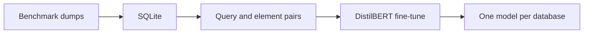

# SemStruct

[](https://www.python.org)
[](https://pytorch.org)
[](https://huggingface.co/docs/transformers)
[](https://huggingface.co/distilbert/distilbert-base-uncased)
[](LICENSE)

SemStruct is a semantic-structural framework for relational keyword search. A user types keywords. The system has to decide which relations, attributes, and cell values those keywords refer to, and later which joined tuples answer the query.

This repository implements the offline half: one English DistilBERT cross-encoder per database. The model reads a keyword query together with a textual description of one schema element and estimates whether that element contributes to an answer. Integrated Candidate Network generation, SQL execution, and end-to-end answer ranking are specified in [docs/architecture.md](docs/architecture.md) and are not implemented here.



## This version

For Mondial, the IMDb 2009 subset, and the Wikipedia 2008 subset:

1. Load the PostgreSQL benchmark dump into SQLite.
2. Build query classes from the foreign-key graph.
3. Sample keyword queries from the cell values of each class.
4. Add the 50 Coffman topics. One third is test data. The other two thirds are train and validation data.
5. Fine-tune `distilbert/distilbert-base-uncased` as a relevance classifier.
6. Compare it with token overlap and with frozen DistilBERT embeddings.

Each pair is one query beside one element. The element is a relation name, an attribute, or a cell value. These dumps have no relation comments, so there is no separate description sample. A comment in another dump would be a line on the relation card, not a fourth label. Positives and negatives are counted separately below. The same three categories appear in train, validation, and test, for both the synthetic queries and the Coffman topics.

| Database | Category | Positive | Negative | Total |
| --- | --- | ---: | ---: | ---: |
| Mondial | Relation | 3,022 | 77 | 3,099 |
| Mondial | Attribute | 2,433 | 329 | 2,762 |
| Mondial | Value | 2,505 | 23,474 | 25,979 |
| Mondial | All | 7,960 | 23,880 | 31,840 |
| IMDb | Relation | 682 | 18 | 700 |
| IMDb | Attribute | 578 | 92 | 670 |
| IMDb | Value | 604 | 5,482 | 6,086 |
| IMDb | All | 1,864 | 5,592 | 7,456 |
| Wikipedia | Relation | 453 | 16 | 469 |
| Wikipedia | Attribute | 374 | 65 | 439 |
| Wikipedia | Value | 442 | 3,726 | 4,168 |
| Wikipedia | All | 1,269 | 3,807 | 5,076 |

The Coffman portion of those totals is 1,840 pairs on Mondial, 1,076 on IMDb, and 1,244 on Wikipedia. On every database the 50 topics split into 29 train, 4 validation, and 17 test.

The synthetic queries in the 15 November training split are separate from those topics. The two numbers in each cell are relevant pairs, then the rest.

| Database | Queries | Relation | Attribute | Value | Pairs |
| --- | ---: | ---: | ---: | ---: | ---: |
| Mondial | 943 | 2,352 / 58 | 1,834 / 246 | 1,834 / 17,756 | 24,080 |
| IMDb | 212 | 458 / 3 | 407 / 22 | 407 / 3,791 | 5,088 |
| Wikipedia | 142 | 289 / 6 | 238 / 32 | 238 / 2,257 | 3,060 |

## Data

The three databases are the evaluation subsets of the Coffman and Weaver relational keyword-search benchmark, not dumps collected for this project and not the full IMDb or Wikipedia archives.

- Paper: Joel Coffman and Alfred C. Weaver, *A Framework for Evaluating Database Keyword Search Strategies*, CIKM 2010. [doi:10.1145/1871437.1871531](https://doi.org/10.1145/1871437.1871531)
- Files: Coffman and Weaver, *Benchmark for Relational Keyword Search*, University of Virginia Dataverse, 2017. [doi:10.18130/V3/KEVCF8](https://doi.org/10.18130/V3/KEVCF8)

`semstruct download` fetches the Mondial, IMDb 2009 subset, and Wikipedia 2008 subset schema, data, and topic files from that Dataverse record and checks their MD5 sums. IMDb topics are the corrected V2 assessments. The benchmark is academic and non-commercial. IMDb rows remain courtesy of IMDb. This repository's MIT license covers the code only. Filenames, checksums, and the manual download list are in [docs/datasets.md](docs/datasets.md).

Test-set pair classification after the 15 November 2026 retraining, Apple Silicon, MPS. The test split mixes held-out synthetic queries with 17 Coffman topics. The [14 November log](docs/logs/2026-11-14-reference-run.md) is the earlier run, before those topics were added to the pairs.

| Database | Pairs used to train | Validation F1 | Test F1 | Test ROC-AUC |
| --- | ---: | ---: | ---: | ---: |
| Mondial | 25,108 | 0.862 | 0.861 | 0.975 |
| IMDb | 5,692 | 0.973 | 0.909 | 0.984 |
| Wikipedia | 3,816 | 0.912 | 0.927 | 0.988 |

## Quick start

Python 3.10 or newer. The reference run used Python 3.12. The same commands run on macOS, Windows, and Linux. Per-platform install notes, including the CUDA wheel, are in [docs/reproduction.md](docs/reproduction.md).

```bash
python -m venv .venv
source .venv/bin/activate
python -m pip install -r requirements.txt
python -m pip install -e .
```

On Windows, activate with `.venv\Scripts\activate`.

```bash
semstruct download --dataset all
semstruct prepare --dataset all
semstruct train --dataset all
semstruct evaluate --dataset all
```

If the Dataverse request fails, place the nine evaluation files named in [docs/datasets.md](docs/datasets.md) in `data/raw/` and run `prepare`. The dumps are not part of this repository. Checkpoints are written to `outputs/models/<dataset>/` and are not uploaded. Metrics go to `outputs/<dataset>/metrics.json`.

## Score a query

Load the checkpoint for the database you are querying. Pass the keyword string beside one element card. The card has to use the training format from `relation_text`, `attribute_text`, and `value_text`: a `[RELATION]`, `[ATTRIBUTE]`, or `[VALUE]` line. The score is the probability that the element is relevant.

```python
import json

from semstruct.device import select_device
from semstruct.model.classifier import load_classifier
from semstruct.model.scoring import relevance_probabilities

tokenizer, model = load_classifier("outputs/models/mondial")
device = select_device()
pairs = []
with open("data/processed/mondial/pairs.jsonl", encoding="utf-8") as handle:
    for line in handle:
        row = json.loads(line)
        if row["query_id"] == "q00029":
            pairs.append(row)
query = pairs[0]["query"]
scores = relevance_probabilities(
    model,
    tokenizer,
    [query] * len(pairs),
    [row["element_text"] for row in pairs],
    batch_size=16,
    device=device,
    max_length=128,
)
for score, row in sorted(zip(scores, pairs), key=lambda item: -item[0]):
    print(f"{score:.3f}  {row['label']}  {row['element_id']}")
```

`q00029` is the held-out Mondial query `montevideo uruguay`, from the class `borders`, `city`, and `country`. Seven of its 28 pairs are relevant. The validation cutoff in `outputs/mondial/metrics.json` is 0.553. The current checkpoint ranks them as follows.

| Score | Label | Element |
| ---: | ---: | --- |
| 0.998 | relevant | relation `country` |
| 0.997 | relevant | relation `city` |
| 0.997 | relevant | relation `borders` |
| 0.997 | relevant | attribute `country.province` |
| 0.997 | relevant | attribute `city.name` |
| 0.937 | irrelevant | value `country.capital = montevideo` |
| 0.934 | relevant | value `city.name = montevideo` |
| 0.900 | relevant | value `country.province = uruguay` |
| 0.880 | irrelevant | value `country.name = uruguay` |
| 0.477 | irrelevant | value `geo_river.river = uruguay` |
| 0.216 | irrelevant | value `geo_river.province = uruguay` |
| 0.006 and below | irrelevant | values that do not contain either keyword |

The gold relations and keyword attributes are the top five. A cell that repeats a keyword without having generated the query can rank beside a gold cell. Cells with neither keyword fall below 0.01. The same cutoff is 0.063 for IMDb and 0.917 for Wikipedia, at `systems.distilbert.test.classification.threshold`.

`keyword_relevance` adds a probability for each whitespace-separated keyword. `query_class_score` is the mean probability of a class's relations and text attributes.

## Documentation

| Document | What it covers |
| --- | --- |
| [Architecture](docs/architecture.md) | Offline adaptation, and the online stage that is not built yet |
| [Datasets](docs/datasets.md) | Coffman and Weaver subsets, citation, and what may not be redistributed |
| [Training](docs/training.md) | Query classes, labels, leakage rules, objective, and metrics |
| [Sample distribution](docs/sample-distribution.md) | How the 15 November pairs were split, with charts |
| [Reproduction](docs/reproduction.md) | macOS, Windows, Linux, and CUDA install paths |
| [Reference run](docs/logs/2026-11-14-reference-run.md) | Commands, epoch metrics, and the full trainer step log |
| [Slides](docs/slides/semstruct-progress.md) | Short Marp deck of what this version implements |

## Layout

```text
configs/                  experiment settings
docs/                     architecture, data, training, reproduction, run log
src/semstruct/            download, preparation, training, evaluation
tests/                    parser, labeling, and metric tests
data/raw/                 benchmark dumps, not committed
data/processed/           SQLite databases and training pairs, not committed
outputs/models/<dataset>  fine-tuned checkpoints, not committed
outputs/<dataset>         metrics and run configuration
```

A query class is a connected set of relations. Sampling a join of that class and reading one or two short text cells produces a keyword query. Relations in the class, the attributes that supplied the keywords, and those cells are positive. Other relations, attributes, and values are negative. The loss is binary cross-entropy on the classifier token of DistilBERT.

## Citation

Code in this repository is MIT, copyright Mostafa Mashhadizadeh. The benchmark data is not. Cite Coffman and Weaver when you use the databases, topics, or relevance assessments. See [CITATION.cff](CITATION.cff) and [docs/references.bib](docs/references.bib).

## License

The software is released under the MIT license in [LICENSE](LICENSE). Mondial, IMDb, and Wikipedia dumps stay under the terms of the Coffman and Weaver benchmark and the upstream data owners. Do not redistribute those dumps.
