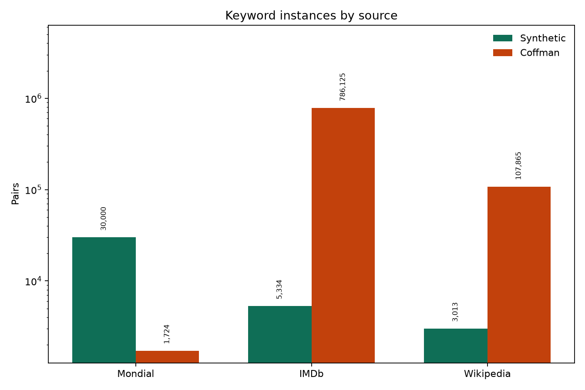
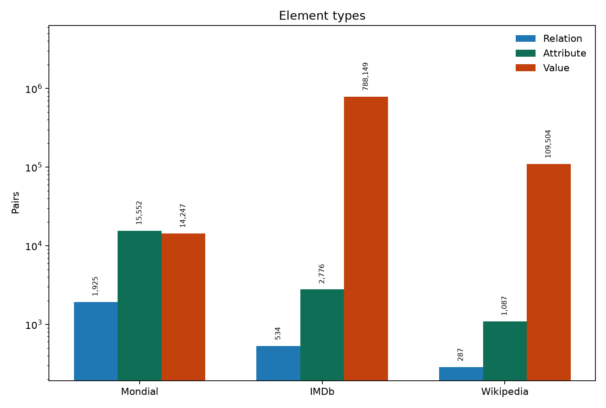
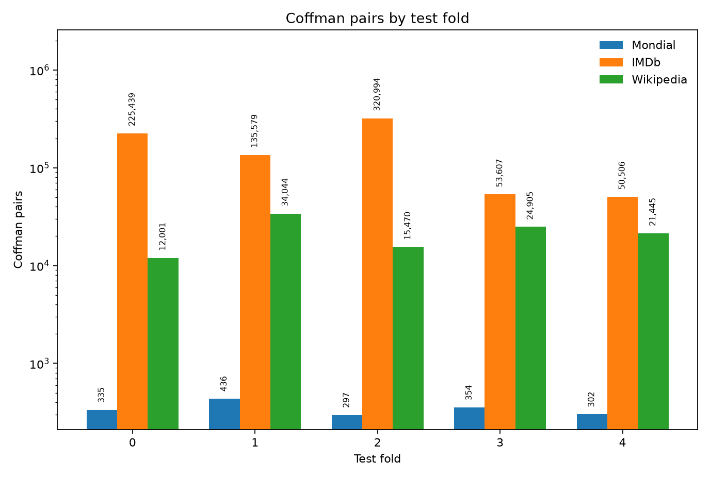
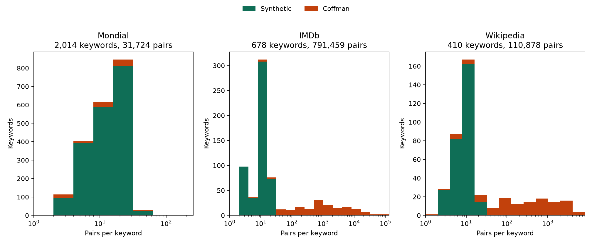

# SemStruct

[](https://www.python.org)
[](https://pytorch.org)
[](https://huggingface.co/docs/transformers)
[](https://huggingface.co/distilbert/distilbert-base-uncased)
[](LICENSE)

SemStruct is a semantic-structural framework for relational keyword search. A user types keywords. The system has to decide which relations, attributes, and cell values those keywords refer to, and later which joined tuples answer the query.

This repository implements the offline half: one English DistilBERT ranker per database, measured with 5-fold Coffman cross-validation. The model reads one keyword, the full query, and a textual description of one element, and estimates whether that element is the intended hit. Integrated Candidate Network generation and SQL execution are specified in [docs/architecture.md](docs/architecture.md) and are not implemented here.

## This version

For Mondial, the IMDb 2009 subset, and the Wikipedia 2008 subset:

1. Load the PostgreSQL benchmark dump into SQLite.
2. Build query classes from the foreign-key graph and sample synthetic keyword queries.
3. Add the 50 Coffman topics. Each fold tests 10 topics, uses 8 to choose the checkpoint and the threshold, and trains on the other 32.
4. Fine-tune `distilbert/distilbert-base-uncased` with one linear unit and binary cross-entropy. Every synthetic instance trains every fold.
5. Report precision, recall, and F1 of the retrieved index hits, plus the mean scoring time.

The query texts are the synthetic queries plus the 50 Coffman topics. A label is positive only for the index hit the topic or the generator assigns to that keyword. Training keeps every schema hit and at most 10 other value hits per keyword, and the reported precision and recall score every index hit. The pre-trained numbers are the frozen [CLS] cosine.

## Ranker results

Pooled over all 50 Coffman topics. These are keyword-element decisions. ICN, Key2Vec, network counts, and end-to-end time are not in this table. Wikipedia is measured beside Mondial and IMDb.

| Database | System | Precision | Recall | F1 | Scoring |
| --- | --- | ---: | ---: | ---: | ---: |
| Mondial | Fine-tuned | 0.455 | 0.787 | 0.576 | 57 ms |
| Mondial | Pre-trained | 0.257 | 0.667 | 0.371 | 90 ms |
| IMDb | Fine-tuned | 0.038 | 0.709 | 0.072 | 42.6 s |
| IMDb | Pre-trained | 0.000 | 0.420 | 0.001 | 46.5 s |
| Wikipedia | Fine-tuned | 0.171 | 0.415 | 0.243 | 6.4 s |
| Wikipedia | Pre-trained | 0.015 | 0.425 | 0.030 | 6.9 s |

## Sample counts

| Database | Synthetic queries | Synthetic pairs | Coffman topics | Coffman pairs |
| --- | ---: | ---: | ---: | ---: |
| Mondial | 984 | 30,000 | 50 | 1,724 |
| IMDb | 268 | 5,334 | 50 | 786,125 |
| Wikipedia | 171 | 3,013 | 50 | 107,865 |

| Database | Category | Positive | Negative | Total |
| --- | --- | ---: | ---: | ---: |
| Mondial | Relation | 1,925 | 0 | 1,925 |
| Mondial | Attribute | 2,057 | 13,495 | 15,552 |
| Mondial | Value | 2,081 | 12,166 | 14,247 |
| Mondial | All | 6,063 | 25,661 | 31,724 |
| IMDb | Relation | 534 | 0 | 534 |
| IMDb | Attribute | 687 | 2,089 | 2,776 |
| IMDb | Value | 709 | 787,440 | 788,149 |
| IMDb | All | 1,930 | 789,529 | 791,459 |
| Wikipedia | Relation | 287 | 0 | 287 |
| Wikipedia | Attribute | 457 | 630 | 1,087 |
| Wikipedia | Value | 607 | 108,897 | 109,504 |
| Wikipedia | All | 1,351 | 109,527 | 110,878 |

## Figures









## Data

The three databases are the evaluation subsets of the Coffman and Weaver relational keyword-search benchmark, not dumps collected for this project and not the full IMDb or Wikipedia archives.

- Paper: Joel Coffman and Alfred C. Weaver, *A Framework for Evaluating Database Keyword Search Strategies*, CIKM 2010. [doi:10.1145/1871437.1871531](https://doi.org/10.1145/1871437.1871531)
- Files: Coffman and Weaver, *Benchmark for Relational Keyword Search*, University of Virginia Dataverse, 2017. [doi:10.18130/V3/KEVCF8](https://doi.org/10.18130/V3/KEVCF8)

`semstruct download` fetches the Mondial, IMDb 2009 subset, and Wikipedia 2008 subset schema, data, and topic files from that Dataverse record and checks their MD5 sums. IMDb topics are the corrected V2 assessments. The benchmark is academic and non-commercial. IMDb rows remain courtesy of IMDb. This repository's MIT license covers the code only. Filenames, checksums, and the manual download list are in [docs/datasets.md](docs/datasets.md).

## Quick start

Python 3.10 or newer. The same commands run on macOS, Windows, and Linux. Per-platform install notes are in [docs/reproduction.md](docs/reproduction.md).

```bash
python -m venv .venv
source .venv/bin/activate
python -m pip install -r requirements.txt
python -m pip install -e .
```

On Windows, activate with `.venv\Scripts\activate`.

```bash
semstruct download --dataset all
semstruct prepare --dataset all
semstruct train --dataset mondial --fold 0
semstruct evaluate --dataset mondial --fold 0
semstruct train --dataset all --fold all
semstruct evaluate --dataset all --fold all
```

Checkpoints are written to `outputs/models/<dataset>/fold-<k>/` and are not uploaded. Pooled ranker numbers go to `outputs/<dataset>/cv-metrics.json`.

## Score a query

Load the fold checkpoint for the database you are querying. Pass the keyword, the full query, and one element card. The score is the sigmoid probability that the element is the intended hit.

```python
from semstruct.device import select_device
from semstruct.model.classifier import load_ranker
from semstruct.model.scoring import relevance_probabilities

tokenizer, model = load_ranker("outputs/models/mondial/fold-0")
scores = relevance_probabilities(
    model,
    tokenizer,
    ["france"],
    ["france"],
    ["value: France | attribute: country.name | relation: country"],
    batch_size=16,
    device=select_device(),
    max_length=128,
)
print(scores[0])
```

## Documentation

| Document | What it covers |
| --- | --- |
| [Architecture](docs/architecture.md) | Offline adaptation, and the online stage that is not built yet |
| [Datasets](docs/datasets.md) | Coffman and Weaver subsets, citation, and what may not be redistributed |
| [Training](docs/training.md) | Keyword instances, folds, loss, and the pooled numbers |
| [Sample distribution](docs/sample-distribution.md) | Pair counts and the charts in `docs/figures/` |
| [Reproduction](docs/reproduction.md) | macOS, Windows, Linux, and CUDA install paths |
| [Latest run](docs/logs/latest-run.md) | The plain log of the current run |
| [Slides](docs/slides/semstruct-progress.md) | Short Marp deck of what this version implements |

## Layout

```text
configs/                         experiment settings
docs/                            architecture, data, training, reproduction, run log
src/semstruct/                   download, preparation, training, evaluation
tests/                           parser, labeling, and metric tests
data/raw/                        benchmark dumps, not committed
data/processed/                  SQLite databases and training pairs, not committed
outputs/models/<dataset>/fold-k  fine-tuned checkpoints, not committed
outputs/<dataset>                metrics and run configuration
exports/training-data/           current pair export, not committed
```

## Citation

Code in this repository is MIT, copyright Mostafa Mashhadizadeh. The benchmark data is not. Cite Coffman and Weaver when you use the databases, topics, or relevance assessments. See [CITATION.cff](CITATION.cff) and [docs/references.bib](docs/references.bib).

## License

The software is released under the MIT license in [LICENSE](LICENSE). Mondial, IMDb, and Wikipedia dumps stay under the terms of the Coffman and Weaver benchmark and the upstream data owners. Do not redistribute those dumps.
