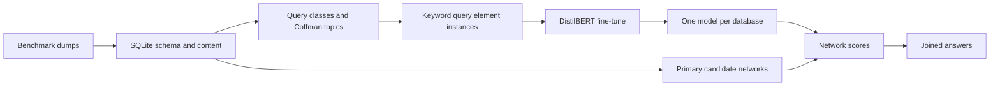

# Architecture

SemStruct has an offline adaptation stage and an online query stage. This repository builds the training pairs, fine-tunes DistilBERT, generates primary candidate networks, scores them, and evaluates the joined answers.

## Offline database adaptation

The offline stage fits a pre-trained DistilBERT model to one relational database.

1. Read relations, attributes, types, primary keys, foreign keys, and comments when the dump has them.
2. Keep a SQLite copy of the rows so later sampling does not need PostgreSQL.
3. Enumerate query classes: connected sets of one, two, or three relations in the foreign-key graph.
4. Draw keyword queries from short text cells in those classes, and load the 50 Coffman topics.
5. Fine-tune DistilBERT on `(keyword, query, element)` instances with one linear unit and binary cross-entropy. Five folds rotate which 10 Coffman topics are held out.
6. Store one checkpoint per fold, the schema, and the run record.

Each database gets its own model. A Mondial model is not used on IMDb.

## Elements

An element is one of three things.

| Element | What it stands for | Text given to the model |
| --- | --- | --- |
| Relation | A table | Name, comment when the dump has one, attribute names, and joined relations |
| Attribute | A text column | Name, type, key role, comment when present, and its relation |
| Value | A cell | The cell text, its attribute, and its relation |

These Coffman dumps have no relation comments, so the description line is absent. The labeling rule is specified in [training.md](training.md).

## Online query processing

Primary candidate networks are generated for the 50 Coffman topics. Each topic is then scored by the fold that held it out, and the best networks are joined on the SQLite benchmark. Top-1, MRR, and MAP are in [Integrated candidate networks](icn.md).

1. Preprocess the keyword query and retrieve a short list of schema and content elements.
2. Score each element with the fine-tuned model. No gradient step is taken at query time.
3. Also score each keyword separately with the same classifier. `semstruct.ranker.scoring.keyword_relevance` does this.
4. Build Integrated Candidate Networks from the high-scoring elements, subject to foreign-key connectivity.
5. Rank those networks by semantic score, structural cost, and keyword coverage.
6. Execute the top networks and rank the joined answers.

A query-class score is the mean relevance probability of the class's relations and text attributes. That aggregate is what a later network generator can use to prefer one join shape over another. `semstruct.ranker.scoring.query_class_score` is that mean.

## What this version evaluates

The experiments measure two stages. The ranker section below is keyword-element retrieval. End-to-end top-1, MRR, and MAP of the joined answers are in [Integrated candidate networks](icn.md). Each fold holds out 10 of the 50 Coffman topics. Eight of the remaining topics choose the checkpoint and the decision threshold, and 32 train, together with every synthetic instance. A hit at or above that threshold is retrieved. Precision, recall, and F1 are pooled over all 50 topics. Scoring time in the ranker table is the mean time to score one test query's index hits. The pre-trained row is a frozen [CLS] cosine on the same texts.
