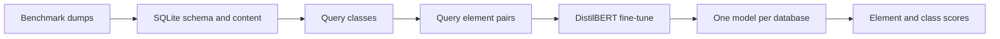

# Architecture

SemStruct has an offline adaptation stage and an online query stage. This repository implements the offline stage and the scoring functions the online stage will call. It does not generate or execute candidate networks.

## Offline database adaptation

The offline stage fits a pre-trained DistilBERT model to one relational database.

1. Read relations, attributes, types, primary keys, foreign keys, and comments when the dump has them.
2. Keep a SQLite copy of the rows so later sampling does not need PostgreSQL.
3. Enumerate query classes: connected sets of one, two, or three relations in the foreign-key graph.
4. Draw keyword queries from short text cells in those classes.
5. Fine-tune DistilBERT as a binary classifier of `(query, element)` pairs.
6. Store the checkpoint, the schema, the example-value lists, and the run configuration.

Each database gets its own model. A Mondial model is not used on IMDb.

## Elements

An element is one of three things.

| Element | What it stands for | Text given to the model |
| --- | --- | --- |
| Relation | A table | Name, attributes, keys, foreign keys, comment if present |
| Attribute | A text column | `relation.attribute`, type, referenced column, a few example values |
| Value | A cell | The cell text, its attribute, and its relation |

Example values that repeat a keyword of the current query are removed from that pair's attribute text. The value element still contains the cell, because recognizing the cell is part of the task. The rule is specified in [training.md](training.md).

## Online query processing

The online stage is the intended consumer of the checkpoint. It is not implemented.

1. Preprocess the keyword query and retrieve a short list of schema and content elements.
2. Score each element with the fine-tuned model. No gradient step is taken at query time.
3. Also score each keyword separately with the same classifier. `semstruct.model.scoring.keyword_relevance` does this.
4. Build Integrated Candidate Networks from the high-scoring elements, subject to foreign-key connectivity.
5. Rank those networks by semantic score, structural cost, and keyword coverage.
6. Execute the top networks and rank the joined answers.

A query-class score is the mean relevance probability of the class's relations and text attributes. That aggregate is what a later network generator can use to prefer one join shape over another. `semstruct.model.scoring.query_class_score` is that mean.

## What this version evaluates

The experiments measure the classifier: pair classification, ranking of the paired candidates, ranking of schema elements, and ranking of query classes on held-out synthetic queries. On the Coffman topics they also measure whether the relations of the judged tuples are ranked above other relations.

They do not measure candidate-network workload or end-to-end retrieval time. Those measurements wait on the network generator.
