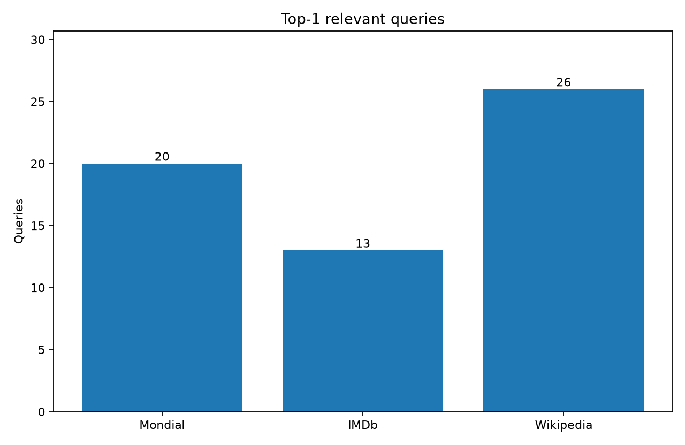
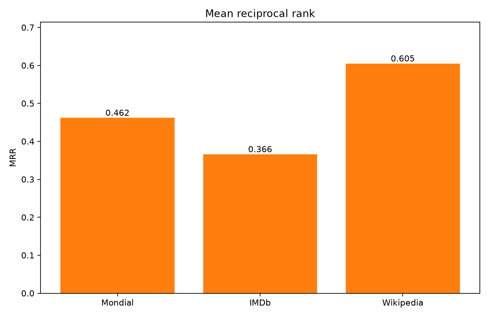
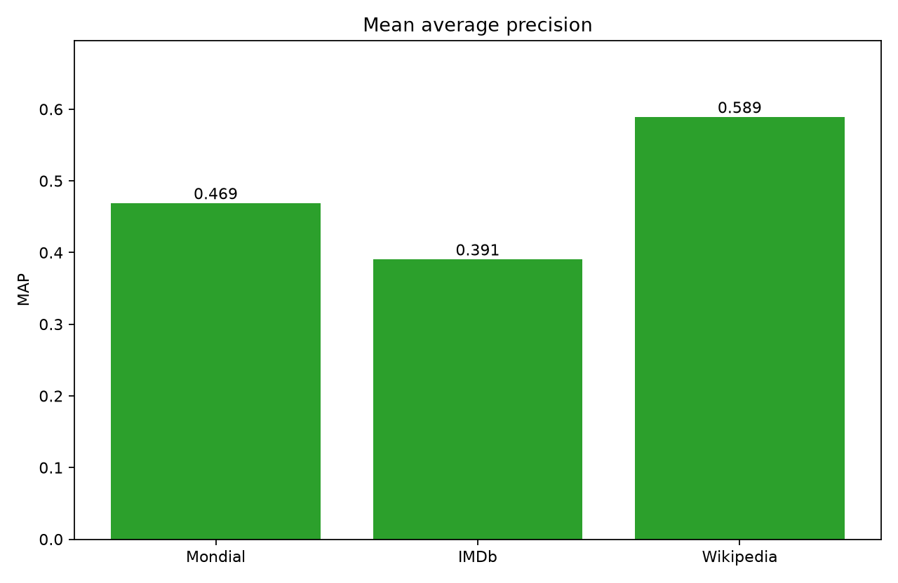

# Integrated candidate networks

Each Coffman topic is scored by the DistilBERT fold that held it out. A keyword on a primary network receives one relevance probability: a relation or attribute uses its schema text, and a value keyword uses the highest probability among the cells of its stored attribute. The network score is the mean of those probabilities. Networks below the fold's validation threshold are dropped, and at most thirty remain. Networks that share a join tree and the same value predicates become one SQL statement on the SQLite benchmark. A joined row is relevant when its set of search ids equals one Coffman answer. The ranked list is cut at 1,000 answers. The files are `outputs/<dataset>/icn/results.json` and `outputs/<dataset>/icn/metrics.json`.

| Database | Topics | Top-1 | MRR | MAP | Scoring | SQL |
| --- | ---: | ---: | ---: | ---: | ---: | ---: |
| Mondial | 50 | 20 | 0.462 | 0.469 | 45.0 ms | 4.2 ms |
| IMDb | 50 | 13 | 0.366 | 0.391 | 43822.5 ms | 1197.3 ms |
| Wikipedia | 50 | 26 | 0.605 | 0.589 | 9006.4 ms | 75.1 ms |

Top-1 counts queries whose first answer is relevant, out of 50. A topic with no relevant answer contributes zero to MRR and MAP. Scoring time and SQL time are means over the 50 topics. They are separate from the ranker scoring time.

The same top-1 count and reciprocal rank were published for four earlier systems on this benchmark. Those papers do not print MAP in the table used here.

| Database | System | Top-1 | Reciprocal rank |
| --- | --- | ---: | ---: |
| Mondial | SemStruct | 20 | 0.462 |
| Mondial | Efficient | 21 | 0.514 |
| Mondial | Effective | 22 | 0.495 |
| Mondial | SPARK | 27 | 0.607 |
| Mondial | Cover density | 36 | 0.804 |
| IMDb | SemStruct | 13 | 0.366 |
| IMDb | Efficient | 4 | 0.139 |
| IMDb | Effective | 3 | 0.072 |
| IMDb | SPARK | 3 | 0.115 |
| IMDb | Cover density | 13 | 0.313 |
| Wikipedia | SemStruct | 26 | 0.605 |
| Wikipedia | Efficient | 16 | 0.485 |
| Wikipedia | Effective | 23 | 0.594 |
| Wikipedia | SPARK | 19 | 0.565 |
| Wikipedia | Cover density | 32 | 0.674 |

The comparison charts use the SemStruct numbers. The count or the rounded metric is printed on each bar.

## Figures

