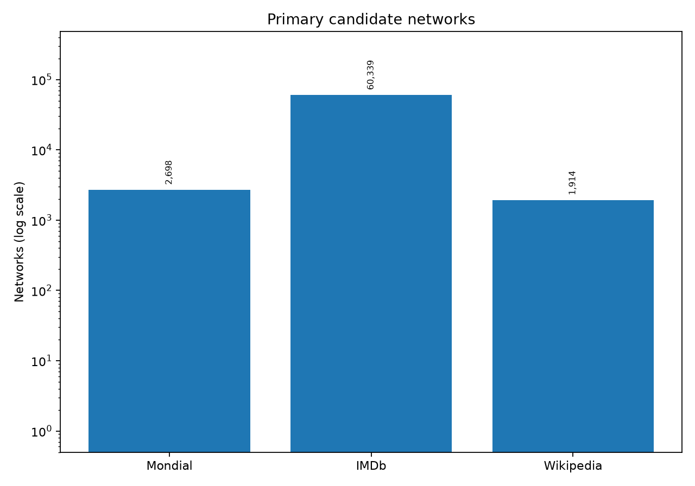
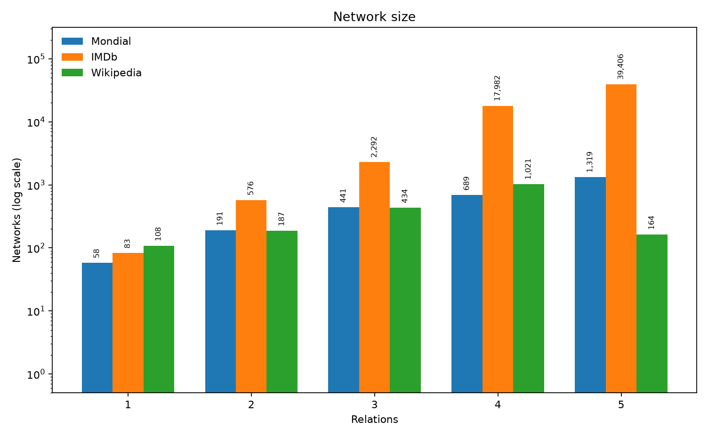
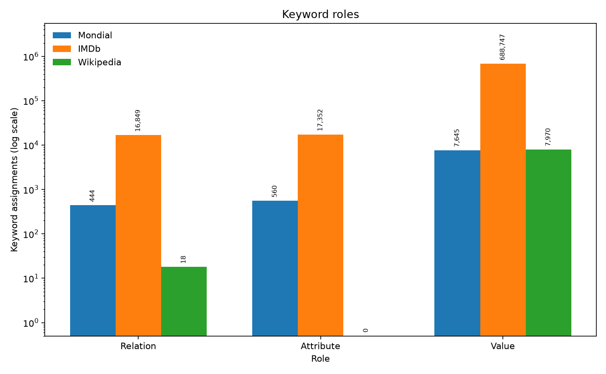
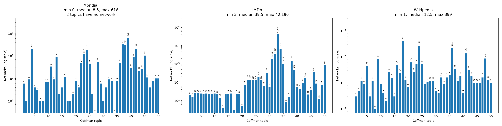
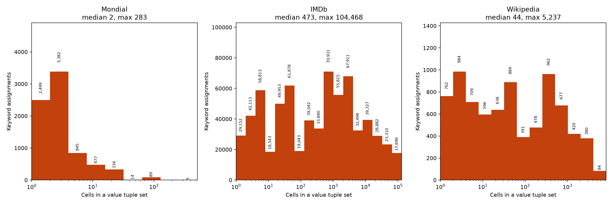

# Primary candidate networks

A primary candidate network is a join tree of tuple sets on the foreign-key graph. Tuple sets come from the database: a relation or attribute whose name matches a keyword, or the cells of one attribute that contain it. The tree has at most five relations. Every keyword appears once. Value keywords that share a relation must occur together in one row, because that row is their tuple set. A relation with no keyword is kept only when it connects keyword relations, and it is never a leaf. The same tree and the same keyword assignment are stored once. The files are `outputs/<dataset>/networks/primary-cns.json`. The IMDb file is about 162 MB, above GitHub's limit, so it stays on disk and is not in the repository. Regenerate it with `semstruct cns --dataset imdb`.

| Database | Topics | With networks | Without networks | Networks | Minimum | Median | Maximum |
| --- | ---: | ---: | ---: | ---: | ---: | ---: | ---: |
| Mondial | 50 | 48 | 2 | 2,698 | 0 | 8.5 | 616 |
| IMDb | 50 | 50 | 0 | 60,339 | 3 | 39.5 | 42,190 |
| Wikipedia | 50 | 50 | 0 | 1,914 | 1 | 12.5 | 399 |

| Database | Size 1 | Size 2 | Size 3 | Size 4 | Size 5 |
| --- | ---: | ---: | ---: | ---: | ---: |
| Mondial | 58 | 191 | 441 | 689 | 1,319 |
| IMDb | 83 | 576 | 2,292 | 17,982 | 39,406 |
| Wikipedia | 108 | 187 | 434 | 1,021 | 164 |

| Database | Relation | Attribute | Value | Free relations | Value match median | Value match maximum |
| --- | ---: | ---: | ---: | ---: | ---: | ---: |
| Mondial | 444 | 560 | 7,645 | 3,242 | 2 | 283 |
| IMDb | 16,849 | 17,352 | 688,747 | 12,426 | 473 | 104,468 |
| Wikipedia | 18 | 0 | 7,970 | 1,310 | 44 | 5,237 |

Minimum, median, and maximum count every topic, including topics with no network. A value match count is the number of cells in that attribute which contain the keyword. The network stores the count, not the cells.

Mondial topics with no network: 27 (nigeria gdp), 34 (suriname ethnic_group).
IMDb: every topic has at least one network.
Wikipedia: every topic has at least one network.

The comparison charts use a logarithmic vertical axis so the smaller databases stay visible. The number printed on each bar is the exact count.

## Figures

