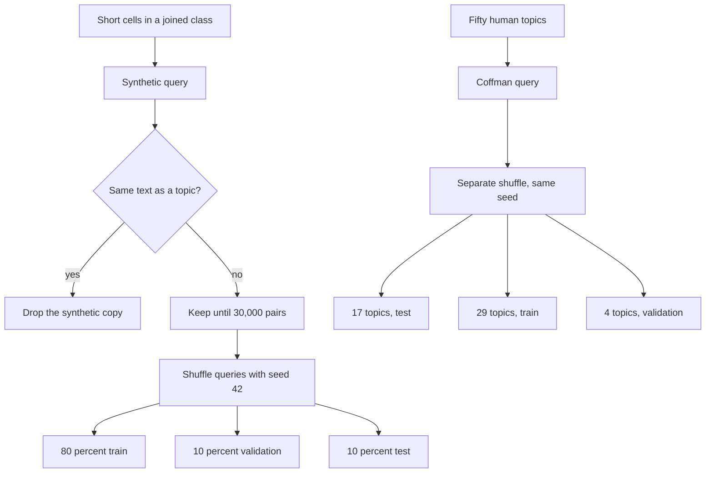

# Sample distribution, 15 November 2026

This note describes the pairs that the 15 November checkpoints were built from. A sample is one keyword query beside one element card, with a relevance label. The row files are in `exports/training-data-2026-11-15/`. Those files contain benchmark cell text and are not part of the git history.

The split is by query, not by pair. Every pair of a query stays in that query's split, so the same wording never appears in both training and test.

## How a query is assigned

Synthetic queries come from connected sets of one to three relations. The relations, the attributes that supplied the keywords, and those cells are relevant. Three other elements are drawn for each relevant one.

A Coffman query uses the judged tuple. Its relation is relevant. A cell in that tuple is a relevant attribute and a relevant value when the cell contains a query keyword. Negatives use the same three-to-one rule. The human topics are not passed through the 30,000-pair cap, so all fifty survive.

Because each relevant element brings three negatives, every split on this run is exactly one quarter relevant.

## Where the training pairs come from

The weights were updated only on `train`. Validation chose the checkpoint. Test was unseen. Coffman is the same size on every database: 29, 4, and 17 topics. The synthetic set is much larger, and it differs by database.

```mermaid
xychart-beta
    title "Train queries by source, 15 November 2026"
    x-axis ["Mondial", "IMDb", "Wikipedia"]
    y-axis "Queries" 0 --> 1000
    bar "Synthetic" [943, 212, 142]
    bar "Coffman" [29, 29, 29]
```

| Database | Train queries | Synthetic pairs | Coffman pairs | Train pairs |
| --- | ---: | ---: | ---: | ---: |
| Mondial | 972 | 24,080 | 1,028 | 25,108 |
| IMDb | 241 | 5,088 | 604 | 5,692 |
| Wikipedia | 171 | 3,060 | 756 | 3,816 |

Mondial's training set is 95.9 percent synthetic pairs. IMDb is 89.4 percent. Wikipedia is 80.2 percent. The human topics are present in every training set, but they are the smaller source.

## Synthetic queries across the three splits

The 80/10/10 rule is applied to queries. Pair counts move a little away from those percents because some queries produce more pairs than others.

```mermaid
xychart-beta
    title "Synthetic queries by split"
    x-axis ["Mondial", "IMDb", "Wikipedia"]
    y-axis "Queries" 0 --> 1000
    bar "Train" [943, 212, 142]
    bar "Validation" [117, 26, 17]
    bar "Test" [119, 28, 19]
```

| Database | Train | Validation | Test | Queries |
| --- | ---: | ---: | ---: | ---: |
| Mondial | 943 | 117 | 119 | 1,179 |
| IMDb | 212 | 26 | 28 | 266 |
| Wikipedia | 142 | 17 | 19 | 178 |

The pair totals for those queries are 30,000 on Mondial, 6,380 on IMDb, and 3,832 on Wikipedia. Mondial stops at the cap. The other two schemas are smaller than the cap, so every synthetic query is kept.

## Human topics

All three databases use the same topic split.

| Split | Topics |
| --- | ---: |
| Train | 29 |
| Validation | 4 |
| Test | 17 |

The number of pairs per topic is not the same, because a topic with more keyword cells produces more relevant elements and therefore more negatives.

| Database | Train pairs | Validation pairs | Test pairs |
| --- | ---: | ---: | ---: |
| Mondial | 1,028 | 240 | 572 |
| IMDb | 604 | 96 | 376 |
| Wikipedia | 756 | 120 | 368 |

## What kind of element a pair is

Most pairs are cell values. Relations and attributes are about a tenth of the training pairs each. The chart is the share of train pairs, in percent.

```mermaid
xychart-beta
    title "Share of train pairs by element, percent"
    x-axis ["Mondial", "IMDb", "Wikipedia"]
    y-axis "Percent of train pairs" 0 --> 100
    bar "Relation" [9.9, 9.3, 9.3]
    bar "Attribute" [8.7, 9.0, 8.5]
    bar "Value" [81.5, 81.7, 82.2]
```

Within the training split, the two numbers in each cell are relevant pairs, then the rest.

| Database | Source | Relation | Attribute | Value |
| --- | --- | ---: | ---: | ---: |
| Mondial | Synthetic | 2,352 / 58 | 1,834 / 246 | 1,834 / 17,756 |
| Mondial | Coffman | 61 / 3 | 84 / 9 | 112 / 759 |
| IMDb | Synthetic | 458 / 3 | 407 / 22 | 407 / 3,791 |
| IMDb | Coffman | 62 / 8 | 37 / 44 | 52 / 401 |
| Wikipedia | Synthetic | 289 / 6 | 238 / 32 | 238 / 2,257 |
| Wikipedia | Coffman | 56 / 3 | 45 / 9 | 88 / 555 |

Relation negatives are scarce. A database has few tables, and the relevant relations are already removed from the negative pool, so most of the three-to-one budget lands on cell values. These dumps have no relation comments, so there is no description category.
