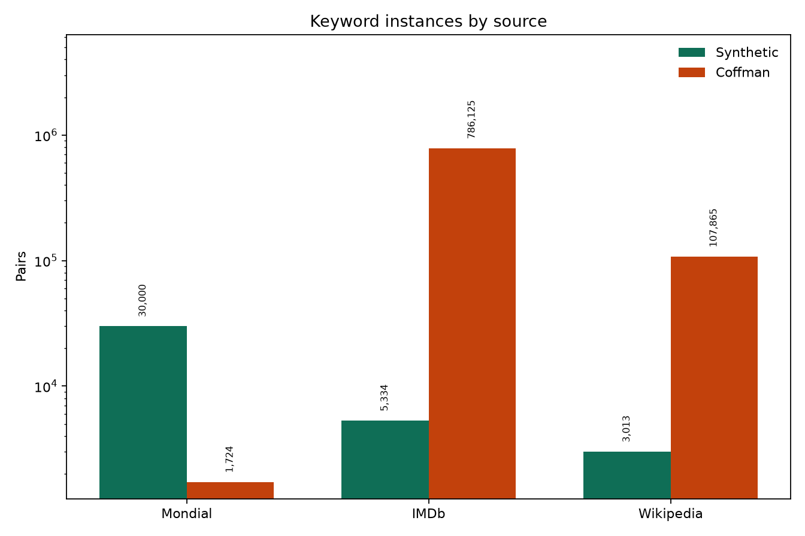
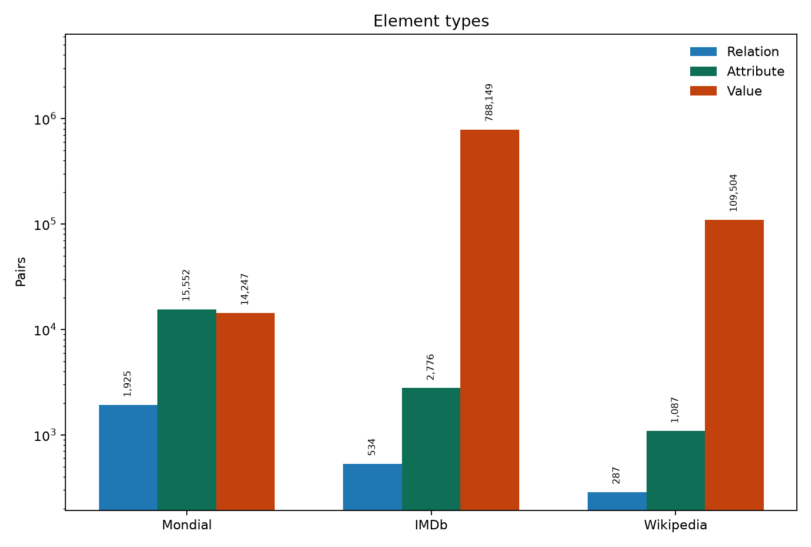
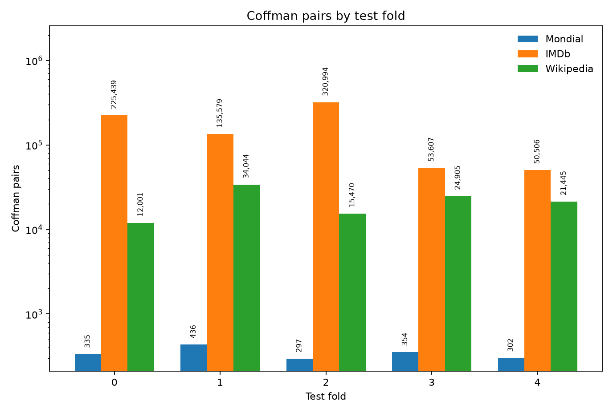
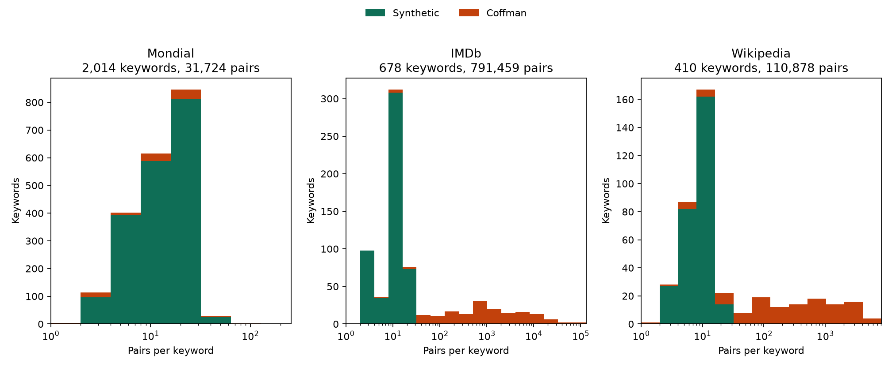

# Sample distribution

This note describes the current keyword instances. A row is one keyword, the full query, and one element. Synthetic rows train every fold. Coffman rows carry the test fold of their topic. The row files are in `exports/training-data/`. Those files contain benchmark cell text and are not part of the git history.

| Database | Synthetic queries | Synthetic pairs | Coffman topics | Coffman pairs |
| --- | ---: | ---: | ---: | ---: |
| Mondial | 984 | 30,000 | 50 | 1,724 |
| IMDb | 268 | 5,334 | 50 | 786,125 |
| Wikipedia | 171 | 3,013 | 50 | 107,865 |

| Database | Category | Positive | Negative | Total |
| --- | --- | ---: | ---: | ---: |
| Mondial | Relation | 1,925 | 0 | 1,925 |
| Mondial | Attribute | 2,057 | 13,495 | 15,552 |
| Mondial | Value | 2,081 | 12,166 | 14,247 |
| Mondial | All | 6,063 | 25,661 | 31,724 |
| IMDb | Relation | 534 | 0 | 534 |
| IMDb | Attribute | 687 | 2,089 | 2,776 |
| IMDb | Value | 709 | 787,440 | 788,149 |
| IMDb | All | 1,930 | 789,529 | 791,459 |
| Wikipedia | Relation | 287 | 0 | 287 |
| Wikipedia | Attribute | 457 | 630 | 1,087 |
| Wikipedia | Value | 607 | 108,897 | 109,504 |
| Wikipedia | All | 1,351 | 109,527 | 110,878 |

| Database | Source | Positive | Negative | Total |
| --- | --- | ---: | ---: | ---: |
| Mondial | synthetic relation | 1,913 | 0 | 1,913 |
| Mondial | synthetic attribute | 1,913 | 13,078 | 14,991 |
| Mondial | synthetic value | 1,913 | 11,183 | 13,096 |
| Mondial | coffman relation | 12 | 0 | 12 |
| Mondial | coffman attribute | 144 | 417 | 561 |
| Mondial | coffman value | 168 | 983 | 1,151 |
| IMDb | synthetic relation | 514 | 0 | 514 |
| IMDb | synthetic attribute | 514 | 1,518 | 2,032 |
| IMDb | synthetic value | 514 | 2,274 | 2,788 |
| IMDb | coffman relation | 20 | 0 | 20 |
| IMDb | coffman attribute | 173 | 571 | 744 |
| IMDb | coffman value | 195 | 785,166 | 785,361 |
| Wikipedia | synthetic relation | 285 | 0 | 285 |
| Wikipedia | synthetic attribute | 285 | 370 | 655 |
| Wikipedia | synthetic value | 285 | 1,788 | 2,073 |
| Wikipedia | coffman relation | 2 | 0 | 2 |
| Wikipedia | coffman attribute | 172 | 260 | 432 |
| Wikipedia | coffman value | 322 | 107,109 | 107,431 |

## Figures

The figures are rendered from that export by `scripts/render_sample_distribution.py`.
