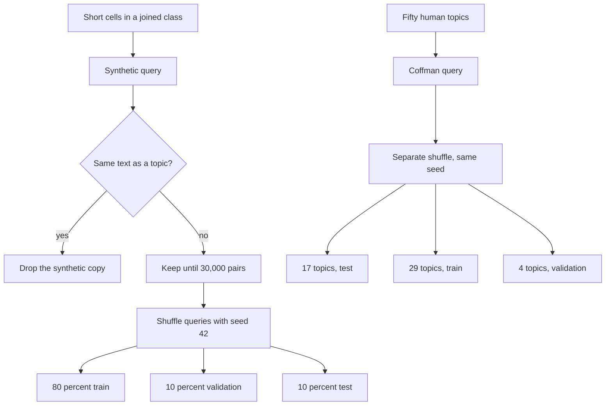
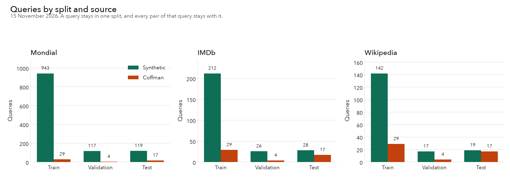
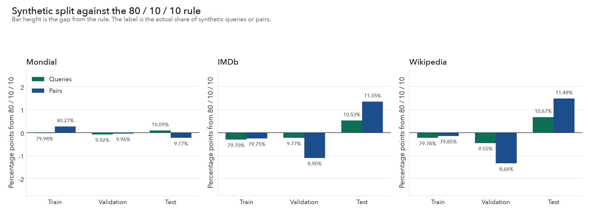
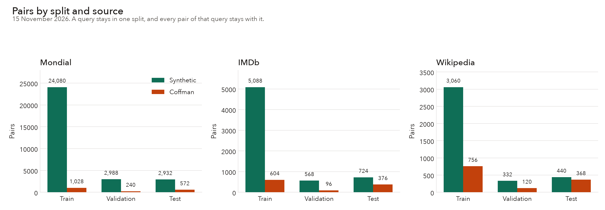
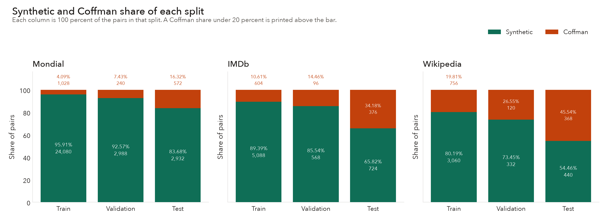
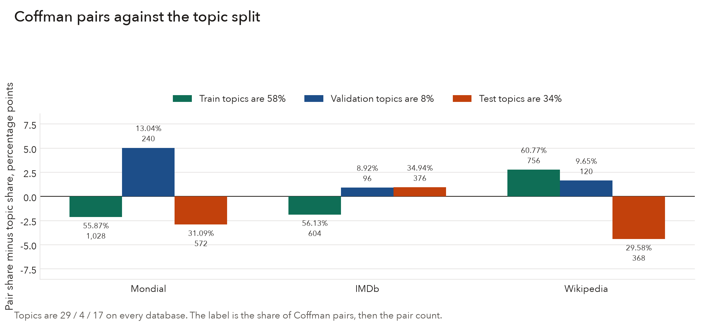
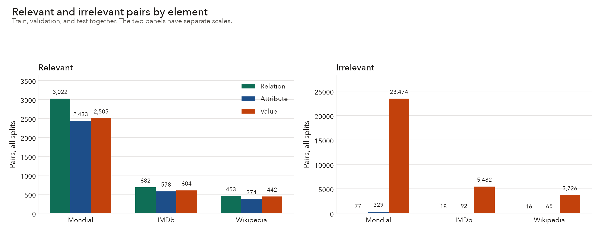
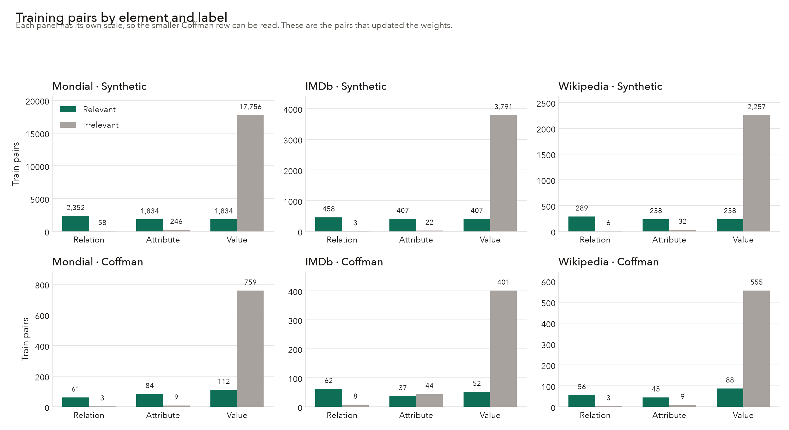
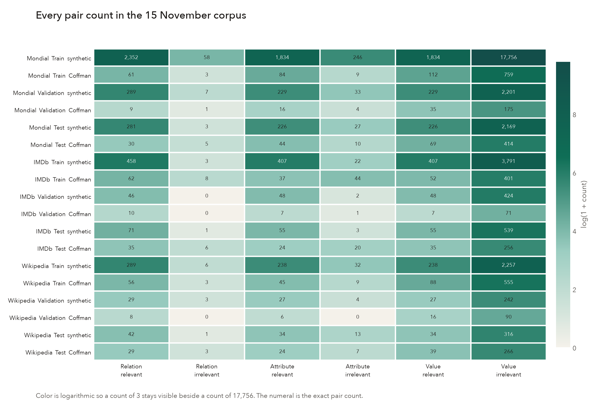
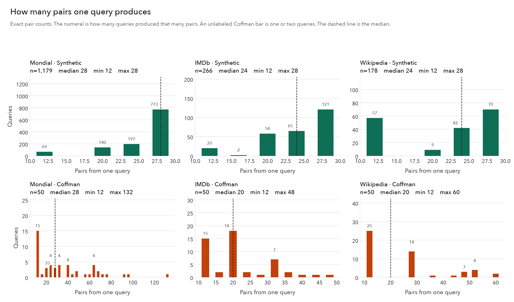

# Sample distribution, 15 November 2026

This note describes the pairs that the 15 November checkpoints were built from. A sample is one keyword query beside one element card, with a relevance label. The row files are in `exports/training-data-2026-11-15/`. Those files contain benchmark cell text and are not part of the git history.

The split is by query, not by pair. Every pair of a query stays in that query's split, so the same wording never appears in both training and test. The figures below are drawn from those row files. Every printed numeral is an exact count or a share rounded to two decimals.

## How a query is assigned

Synthetic queries come from connected sets of one to three relations. The relations, the attributes that supplied the keywords, and those cells are relevant. Three other elements are drawn for each relevant one.

A Coffman query uses the judged tuple. Its relation is relevant. A cell in that tuple is a relevant attribute and a relevant value when the cell contains a query keyword. Negatives use the same three-to-one rule. The human topics are not passed through the 30,000-pair cap, so all fifty survive.

Because each relevant element brings three negatives, every query on this run has exactly one relevant pair for every three irrelevant pairs. The same ratio holds for every split.

## Queries in each split

Coffman is the same size on every database: 29 train, 4 validation, and 17 test. The synthetic set is what changes the totals.

| Database | Synthetic train | Synthetic validation | Synthetic test | Synthetic queries | All queries |
| --- | ---: | ---: | ---: | ---: | ---: |
| Mondial | 943 | 117 | 119 | 1,179 | 1,229 |
| IMDb | 212 | 26 | 28 | 266 | 316 |
| Wikipedia | 142 | 17 | 19 | 178 | 228 |

The 80/10/10 rule is applied to synthetic queries. The bars below are the gap from that rule, in percentage points. The label is the actual share.

Query shares stay within one percentage point of the rule. Pair shares move a little farther, because some queries produce more pairs than others. Mondial is the closest: its synthetic pairs are 80.27 percent train, 9.96 percent validation, and 9.77 percent test. Wikipedia's synthetic test queries are 10.67 percent of its synthetic queries, and those queries produce 11.48 percent of its synthetic pairs.

## Pairs in each split

| Database | Train pairs | Validation pairs | Test pairs | All pairs |
| --- | ---: | ---: | ---: | ---: |
| Mondial | 25,108 | 3,228 | 3,504 | 31,840 |
| IMDb | 5,692 | 664 | 1,100 | 7,456 |
| Wikipedia | 3,816 | 452 | 808 | 5,076 |

The next figure shows what fraction of each split comes from each source. A Coffman share under 20 percent is printed above the bar so the small band stays readable.

Mondial's training set is 95.91 percent synthetic pairs (24,080 of 25,108). IMDb's is 89.39 percent (5,088 of 5,692). Wikipedia's is 80.19 percent (3,060 of 3,816). The human topics are in every training set, and they are the smaller source. They are a larger part of the test split, because 17 of the 50 topics are held out while only about 10 percent of the synthetic queries are.

The topic split itself does not vary. What varies is how many pairs those topics produce.

| Database | Train pairs | Validation pairs | Test pairs | Coffman pairs |
| --- | ---: | ---: | ---: | ---: |
| Mondial | 1,028 | 240 | 572 | 1,840 |
| IMDb | 604 | 96 | 376 | 1,076 |
| Wikipedia | 756 | 120 | 368 | 1,244 |

Topics are 58 percent train, 8 percent validation, and 34 percent test. Mondial's four validation topics produce 13.04 percent of its Coffman pairs. Wikipedia's 29 training topics produce 60.77 percent of its Coffman pairs, and its 17 test topics produce 29.58 percent.

The synthetic pair totals are 30,000 on Mondial, 6,380 on IMDb, and 3,832 on Wikipedia. Mondial stops at the cap. The other two schemas are smaller than the cap, so every synthetic query is kept.

## Relation, attribute, and value

Relevant elements are spread across the three categories. Irrelevant elements are mostly cell values, because a database has few relations left once the relevant ones are removed from the negative pool.

| Database | Element | Relevant | Irrelevant | Total |
| --- | --- | ---: | ---: | ---: |
| Mondial | Relation | 3,022 | 77 | 3,099 |
| Mondial | Attribute | 2,433 | 329 | 2,762 |
| Mondial | Value | 2,505 | 23,474 | 25,979 |
| IMDb | Relation | 682 | 18 | 700 |
| IMDb | Attribute | 578 | 92 | 670 |
| IMDb | Value | 604 | 5,482 | 6,086 |
| Wikipedia | Relation | 453 | 16 | 469 |
| Wikipedia | Attribute | 374 | 65 | 439 |
| Wikipedia | Value | 442 | 3,726 | 4,168 |

These dumps have no relation comments, so there is no description category.

The share is stable across splits. In the figure, relation is the bottom band, attribute is the middle band, and value is the large upper band.

Value is 80.45 to 82.96 percent of every split. Relation and attribute are each about 8 to 10 percent.

The weights were updated only on the training split. Each panel below has its own scale.

Within the training split, the two numbers in each cell are relevant pairs, then irrelevant pairs.

| Database | Source | Relation | Attribute | Value |
| --- | --- | ---: | ---: | ---: |
| Mondial | Synthetic | 2,352 / 58 | 1,834 / 246 | 1,834 / 17,756 |
| Mondial | Coffman | 61 / 3 | 84 / 9 | 112 / 759 |
| IMDb | Synthetic | 458 / 3 | 407 / 22 | 407 / 3,791 |
| IMDb | Coffman | 62 / 8 | 37 / 44 | 52 / 401 |
| Wikipedia | Synthetic | 289 / 6 | 238 / 32 | 238 / 2,257 |
| Wikipedia | Coffman | 56 / 3 | 45 / 9 | 88 / 555 |

The heatmap is the full cross-tabulation. Color is logarithmic so a count of 0 or 3 stays visible beside 17,756. The numeral in each cell is the exact pair count.

Four validation cells have no irrelevant element left to draw. IMDb validation has no irrelevant relation, from either source. Wikipedia validation has no irrelevant Coffman relation and no irrelevant Coffman attribute. The sampler had already used every element of that kind.

## How many pairs one query produces

Every query produces a multiple of four pairs. The dashed line is the median. A Coffman bar with no numeral is one or two queries.

Synthetic queries take only a few sizes.

| Pairs from one query | Mondial | IMDb | Wikipedia |
| ---: | ---: | ---: | ---: |
| 12 | 69 | 20 | 57 |
| 16 | 0 | 2 | 0 |
| 20 | 140 | 58 | 9 |
| 24 | 197 | 65 | 42 |
| 28 | 773 | 121 | 70 |

Mondial's median synthetic query produces 28 pairs. The IMDb and Wikipedia medians are 24.

Coffman queries vary more, because a topic with more keyword cells produces more relevant elements.

| Pairs from one query | Mondial | IMDb | Wikipedia |
| ---: | ---: | ---: | ---: |
| 12 | 15 | 15 | 25 |
| 16 | 1 | 2 | 0 |
| 20 | 3 | 18 | 0 |
| 24 | 4 | 2 | 0 |
| 28 | 3 | 1 | 14 |
| 32 | 4 | 7 | 0 |
| 36 | 0 | 2 | 1 |
| 40 | 4 | 1 | 0 |
| 44 | 1 | 1 | 1 |
| 48 | 2 | 1 | 3 |
| 52 | 0 | 0 | 4 |
| 56 | 1 | 0 | 0 |
| 60 | 1 | 0 | 2 |
| 64 | 4 | 0 | 0 |
| 68 | 2 | 0 | 0 |
| 72 | 1 | 0 | 0 |
| 76 | 1 | 0 | 0 |
| 92 | 1 | 0 | 0 |
| 96 | 1 | 0 | 0 |
| 132 | 1 | 0 | 0 |

The Coffman medians are 28 pairs on Mondial and 20 pairs on IMDb and Wikipedia. One Mondial topic produces 132 pairs, which is why that database's validation topics can outweigh their 8 percent share of the topics.

The figures are rendered from the 15 November export by `scripts/render_sample_distribution.py`.
